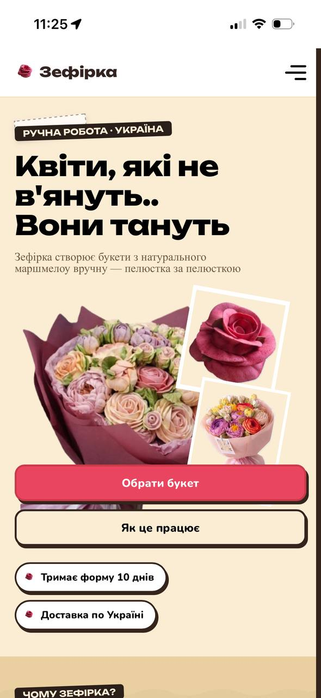
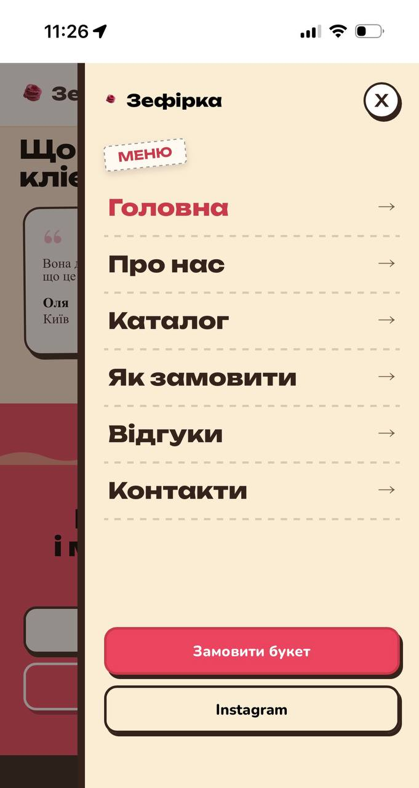
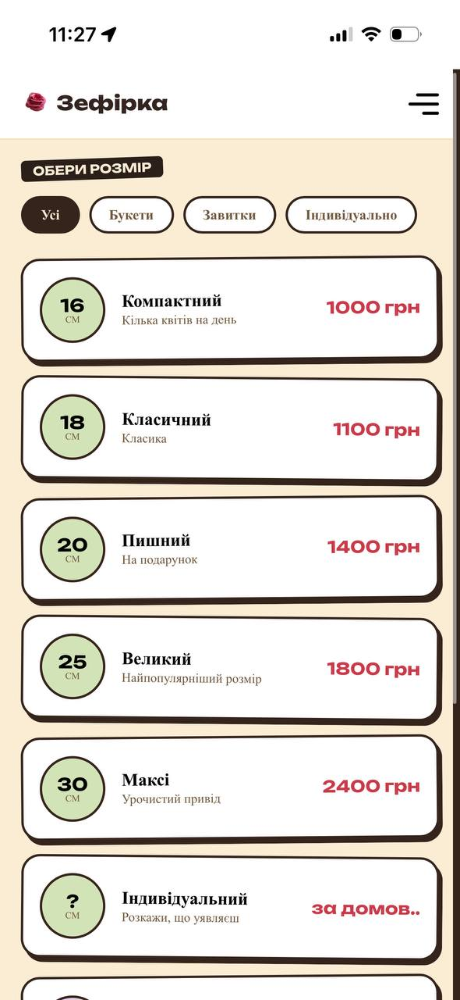
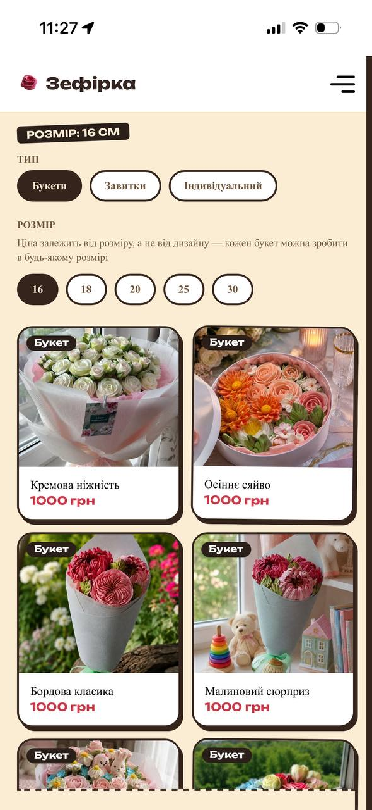
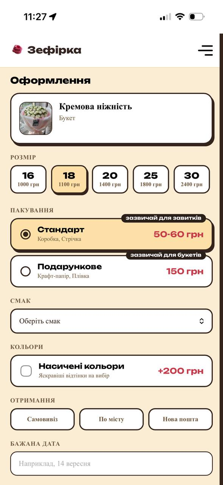
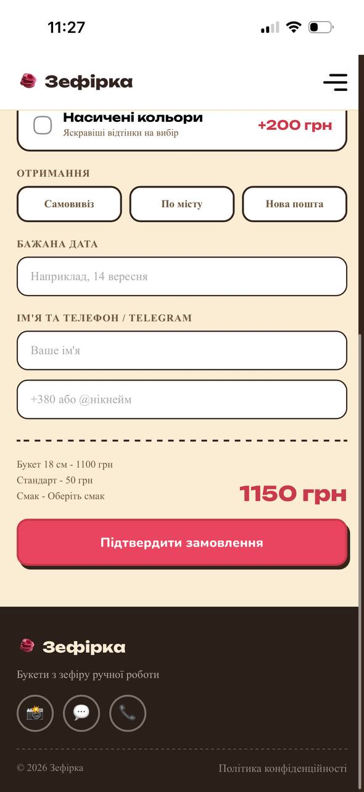
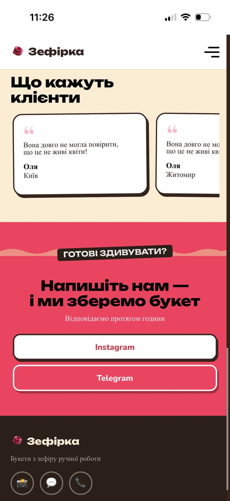
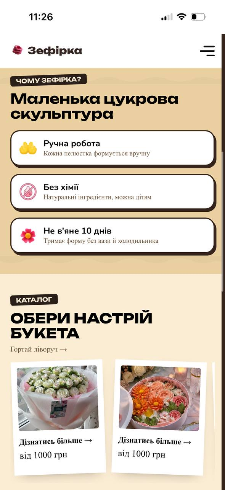
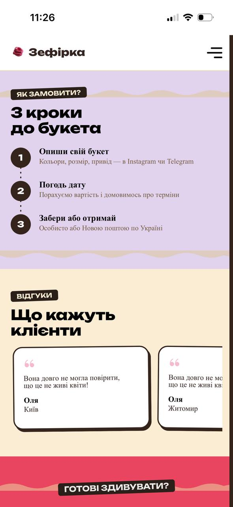
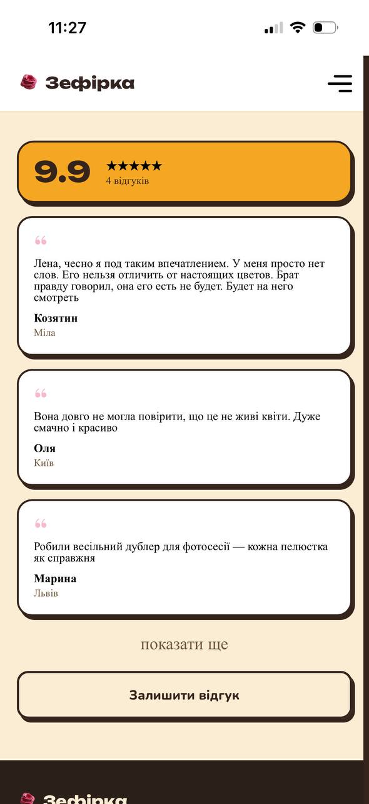

# Zefirka — Marshmallow Flower Bouquets

<div align="center">

# 🌸 Zefirka

**A mobile-first e-commerce showcase for handmade marshmallow flower bouquets.**

[**Live demo →**](https://zefirko.com)


> A solo-built, end-to-end project for a real small business — from a custom visual design system to a working order pipeline, database-backed review moderation, and live deployment.

</div>

---

<p align="center">
  
</p>

## 📸 Screenshots

<table>
  <tr>
    <td align="center" width="33%">
      
      <br><sub><b>Hero</b><br>Main landing section</sub>
    </td>
    <td align="center" width="33%">
      
      <br><sub><b>Menu</b><br>Navigation and categories</sub>
    </td>
    <td align="center" width="33%">
      
      <br><sub><b>Catalog</b><br>Browse bouquet designs</sub>
    </td>
  </tr>
  <tr>
    <td align="center" width="33%">
      
      <br><sub><b>Gallery</b><br>Filter designs and sizes</sub>
    </td>
    <td align="center" width="33%">
      
      <br><sub><b>Bouquet order</b><br>Ready-made bouquet ordering</sub>
    </td>
    <td align="center" width="33%">
      
      <br><sub><b>Delivery</b><br>Delivery options and validation</sub>
    </td>
  </tr>
  <tr>
    <td align="center" width="33%">
      
      <br><sub><b>Call to action</b><br>Conversion-focused section</sub>
    </td>
    <td align="center" width="33%">
      
      <br><sub><b>Main page</b><br>Landing page section</sub>
    </td>
    <td align="center" width="33%">
      
      <br><sub><b>Main page</b><br>Additional landing page section</sub>
    </td>
  </tr>
  <tr>
    <td align="center" width="33%">
      
      <br><sub><b>Reviews</b><br>Customer feedback</sub>
    </td>
    <td colspan="2"></td>
  </tr>
</table>

---

## ✨ Features

**Product catalog**

- Browse marshmallow flower bouquet designs by size and category.
- Separate ordering options for ready-made bouquets, marshmallow curls, and fully custom requests.
- Live-filtered gallery with prices that update automatically when the selected size changes.
- Lazy-loaded WebP images for more efficient loading.

**Ordering system**

- Three tailored order flows: ready bouquet, curl, and custom request.
- Delivery-method-aware validation.
- Live price breakdown before submission.
- Orders are sent directly to the shop owner through a Telegram bot.

**Review system**

- Customers can submit reviews through the website.
- New reviews enter a moderation queue before publication.
- Approve or reject reviews using inline Telegram buttons.
- Approved reviews appear on the website automatically.
- Supabase Row Level Security enforces review visibility and submission rules at the database level.

**Design and user experience**

- Mobile-first layout designed around the shop's Instagram and Telegram audience.
- Custom craft-paper-inspired visual design system.
- Handcrafted illustrations instead of stock photography.
- Scroll-triggered reveal animations.
- Custom styling without a UI component framework.

---

## 🧱 Tech stack

| Area              | Tools                                  |
| ----------------- | -------------------------------------- |
| Frontend          | React 18, Vite, JavaScript             |
| Routing           | React Router, nested dynamic routes    |
| Styling           | CSS Modules, custom design system      |
| Animations        | Framer Motion                          |
| Backend           | Vercel Serverless Functions            |
| Database          | Supabase, PostgreSQL                   |
| Database security | Supabase Row Level Security            |
| Notifications     | Telegram Bot API                       |
| Moderation        | Telegram inline keyboards and webhooks |
| Hosting           | Vercel                                 |

---

## 🏗️ Architecture highlights

- **Centralized product data:** bouquet designs are stored in plain JavaScript arrays under `/data`. Pricing is maintained separately from the design definitions, avoiding duplicated prices across multiple product objects when a size price changes.

- **Dedicated order flows:** ready-made bouquets, curls, and custom requests have their own ordering logic, including validation based on the selected delivery method.

- **Server-side secrets:** the Telegram bot token and Supabase service role key are stored in Vercel environment variables and are never exposed in the client bundle.

- **Database-level review security:** Supabase RLS policies restrict public `SELECT` operations to approved reviews and allow public `INSERT` operations only when a review has `status = 'pending'`.

- **Telegram-based moderation:** review submissions are routed to the shop owner for approval or rejection through inline buttons. Approved reviews are then available on the website.

- **Serverless backend:** Vercel Serverless Functions handle backend operations without requiring a dedicated always-on server.

- **Direct route support:** `vercel.json` rewrites frontend routes to `index.html`, allowing routes such as `/Catalog` to load correctly when opened directly or refreshed.

- **Dynamic navigation:** React Router supports nested dynamic routes, including paths such as `/gallery/:size/:type`.

---

## 🚀 Getting started

**Requirements:** Node.js, npm, a Supabase project, a Telegram bot, and a Vercel account for serverless development and deployment.

Clone the repository and install dependencies:

```bash
git clone YOUR_REPOSITORY_URL
cd Zefirka
npm install
```

### Environment variables

Create a `.env.local` file in the project root:

```env
TELEGRAM_BOT_TOKEN=
TELEGRAM_CHAT_ID=

SUPABASE_SERVICE_ROLE_KEY=

VITE_SUPABASE_URL=
VITE_SUPABASE_ANON_KEY=
```

Fill in the values using your own project credentials.

**Security note:** never commit `.env.local` or expose `TELEGRAM_BOT_TOKEN` and `SUPABASE_SERVICE_ROLE_KEY` to the browser. Keep privileged credentials exclusively in server-side environment variables.

### Run locally

Start the frontend development server:

```bash
npm run dev
```

For local development that includes Vercel Serverless Functions:

```bash
npx vercel dev
```

The serverless development setup requires the environment variables above.

---

## 🎨 Design approach

The visual identity is inspired by craft paper, handmade confectionery, and floral arrangements. Instead of relying on a pre-built UI framework or generic stock photography, the project uses a custom design system with illustrated elements and tailored styling.

The interface was deliberately designed **mobile-first** because customers primarily discover and contact this home-based business through Instagram and Telegram on their phones.

---

## 👤 Author

**RVasyliuk-2003** — Frontend Developer, Wrocław, Poland

[GitHub](https://github.com/RVasyliuk-2003) · [Live demo](https://zefirko.com)

Built solo as a self-directed learning project and deployed for a real business, with a working order pipeline and database-backed review moderation.
